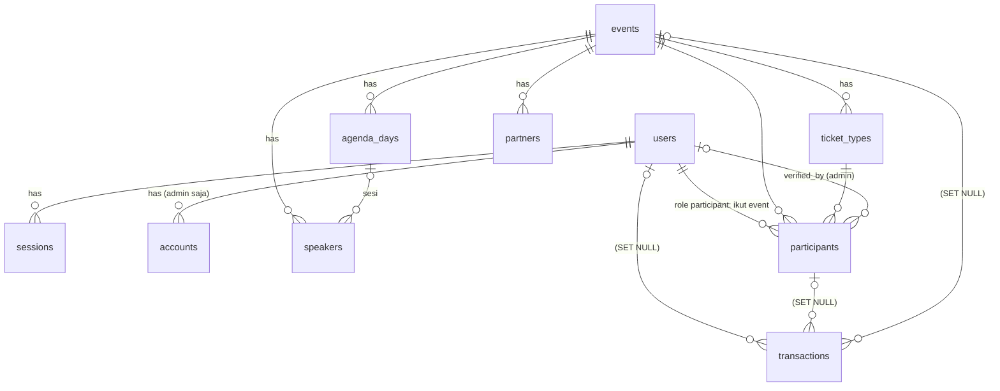

# APCR CMS — Rencana Database

Sumber: desain kanvas "APCR CMS Admin Panel (Modul 4.14)" — Login, Dashboard, Peserta (daftar + detail),
Transaksi (daftar + detail), Event (daftar, form, detail, hapus), Template email.

Stack: Bun · Nuxt 4 · PostgreSQL · Drizzle ORM (`drizzle-orm/bun-sql` + `drizzle-kit`) · Better Auth · Zod · Nuxt UI.

### Runtime: Bun

- Package manager & runtime: `bun install`, `bun --bun nuxt dev`, build dengan Nitro preset `bun` (`bun .output/server/index.mjs`).
- Driver DB: client Postgres bawaan Bun (`Bun.SQL`) lewat `drizzle-orm/bun-sql` — tanpa paket `pg`/`postgres`.
- Migrasi & seed: `bunx drizzle-kit generate` / `bunx drizzle-kit migrate`, `bun run server/db/seed.ts`.
- Better Auth memakai adapter Drizzle (`provider: "pg"`) di atas instance db yang sama.
- Catatan: `drizzle-kit` menjalankan migrasi dengan driver Node miliknya sendiri; kalau `bun-sql` belum didukung di sana, migrasi dijalankan lewat `migrate()` dari `drizzle-orm/bun-sql/migrator` di script Bun.

---

## 1. Prinsip

| Keputusan | Pilihan | Alasan |
|---|---|---|
| Primary key | `uuid` (v7, digenerate di app) | Urut waktu → index B-tree tetap rapi; aman diekspos di URL. Better Auth diset `generateId: "uuid"` supaya seragam. |
| Kode yang dilihat manusia | Kolom terpisah, unik: `REG-APCR-26-01248`, `INV-APCR-26-01248`, `APCR26-ID-0712` | Desain menampilkan kode ini di tabel, email, dan pencarian. |
| Uang | `bigint` rupiah utuh (tanpa desimal), `currency` default `IDR` | Semua harga di desain bulat rupiah; hindari float. |
| Waktu | `timestamptz`; tanggal acara `date`; `events.timezone` default `Asia/Jakarta` | Desain menampilkan "WIB"; peserta lintas ASEAN. |
| Status | `pgEnum` + label Bahasa Indonesia di UI (map di `shared/`) | Enum DB = kontrak; label bisa berubah tanpa migrasi. |
| Detail transaksi | Satu tabel `transactions`; rincian, info pembayaran, dan riwayat status disimpan sebagai `jsonb` | Keputusan: semua transaksi di satu tabel. Kolom yang difilter/di-sort tetap kolom biasa. |
| Email | **Statis** — template di kode (`server/emails/*.ts`), bukan di database | Keputusan: email statis. Halaman "Template email" hanya pratinjau read-only. |
| Hapus | Hard delete (permanen, tanpa `deleted_at`), **kecuali** transaksi | Desain: "Riwayat transaksi tetap tersimpan untuk laporan keuangan" → FK `SET NULL` + snapshot di json. |
| Validasi | Zod schema dari `drizzle-zod` (`createInsertSchema`) lalu di-extend; bentuk kolom `jsonb` juga punya schema Zod + `$type<>()` | Satu sumber kebenaran untuk server route & form Nuxt UI. |

---

## 2. Diagram relasi



Total: **4 tabel auth + 7 tabel domain** (`events`, `agenda_days`, `speakers`, `partners`, `ticket_types`, `participants`, `transactions`).

Admin dan peserta sama-sama ada di `users`, dibedakan dengan `role`. `participants` sekarang hanya
menyimpan **keikutsertaan** seorang user di satu event (tipe tiket, status verifikasi, status bayar, e-tiket).

---

## 3. Tabel

### 3.1 Auth (Better Auth, dibuat via `bunx @better-auth/cli generate`)

`users`, `sessions`, `accounts`, `verifications` — tabel Better Auth, nama jamak lewat opsi adapter Drizzle `usePlural: true`.
Plugin **admin** menambah di `users`: `role`, `banned`, `ban_reason`, `ban_expires`; di `sessions`: `impersonated_by`.

#### `users` — admin **dan** peserta

| Kolom | Tipe | Catatan |
|---|---|---|
| id | uuid | |
| name | varchar | nama lengkap |
| email | citext **unik** | satu orang = satu user, dipakai lintas event |
| email_verified | boolean | bawaan Better Auth |
| image | text null | bawaan Better Auth |
| role | varchar | `admin` · `participant` (plugin admin; `defaultRole: "participant"`, `adminRoles: ["admin"]`) |
| banned / ban_reason / ban_expires | | bawaan plugin admin |
| phone | varchar null | E.164 — field tambahan (`user.additionalFields`) |
| organization | varchar null | "Instansi" |
| job_title | varchar null | "Jabatan" |
| country | char(2) null | ISO-3166 |
| city | varchar null | |
| tshirt_size | `tshirt_size` null | XS…XXXL |
| meal_preference | varchar null | "Halal" |
| referral_source | varchar null | "Sumber info" |
| created_at / updated_at | timestamptz | "Terdaftar sejak" |

Field profil peserta didaftarkan sebagai `additionalFields` dengan `input: false`, jadi hanya bisa diisi dari server (form pendaftaran / CMS), bukan dari endpoint auth.

#### Aturan auth

- **Admin**: login email + password (layar 01) → punya baris di `accounts` (provider `credential`). Dibuat lewat seed / admin lain. Sign-up publik **dimatikan** (`disableSignUp`).
- **Peserta**: user dibuat **otomatis** saat mengisi form pendaftaran event (lihat §6). Tidak punya password / baris `accounts`, jadi tidak bisa login.
- Semua route CMS (`/api/admin/**`, halaman admin) dijaga middleware: session wajib ada **dan** `role = 'admin'`.
- Kalau nanti peserta perlu login (lihat status pendaftaran / unduh e-tiket), cukup tambah plugin magic link / email OTP — tabelnya tidak berubah.

### 3.2 `events`

| Kolom | Tipe | Catatan |
|---|---|---|
| id | uuid PK | |
| code | varchar(8) unik | `APCR`, `PRE`, `ATR` — prefix nomor REG/INV/tiket |
| slug | varchar unik | untuk "Lihat di website" |
| name | varchar(200) | "APCR 2026" |
| tagline | varchar(255) null | opsional |
| description | text | |
| start_date / end_date | date | check `end_date >= start_date` |
| registration_deadline | timestamptz | "25 November 2026, 23.59 WIB" |
| venue_name | varchar | "Santika Premiere Dyandra" |
| venue_address | text null | |
| city | varchar | "Medan" |
| capacity | integer | 1.450 |
| banner_key | text null | object key di Cloudflare R2; upload 1920×1080 ≤ 5 MB |
| status | `event_status` | `draft` · `published` · `archived` |
| registration_open | boolean default true | toggle "Buka pendaftaran" |
| timezone | varchar default `Asia/Jakarta` | |
| registration_seq / invoice_seq | integer default 0 | counter nomor; di-increment `UPDATE … RETURNING` dalam transaksi DB |
| created_by | uuid → user (SET NULL) | |
| created_at / updated_at / published_at | timestamptz | |

### 3.3 `agenda_days`
`id`, `event_id` → events **CASCADE**, `sort_order` int, `label` ("SUMATRA"), `date` date, `theme` varchar, `body` text.
Unik `(event_id, sort_order)`.

### 3.4 `speakers`
`id`, `event_id` → events **CASCADE**, `agenda_day_id` → agenda_days **SET NULL** (kolom "Sesi"), `name`, `title` ("Jabatan & institusi"), `category` `speaker_category` (`government` · `business` · `academia` · `communication`), `photo_key` (R2), `status` `publish_status` (`draft` · `published`), `sort_order`, timestamps.

### 3.5 `partners`
`id`, `event_id` → events **CASCADE**, `name`, `logo_key` (R2), `category` `partner_category`
(`academic_home` · `government_regional` · `strategic` · `business_industry` · `knowledge_research` · `technology` · `media`), `sort_order`, timestamps.

### 3.6 `ticket_types`

| Kolom | Tipe | Catatan |
|---|---|---|
| id, event_id → events CASCADE | | |
| code | varchar(6) | `ID`, `INT`, `CORP` → kode e-tiket `APCR26-ID-0712` |
| name | varchar | "Indonesia Delegate" |
| price | bigint | rupiah |
| pax_per_ticket | smallint default 1 | Corporate = 5 ("Rp 15.000.000 / 5 orang") |
| quota | integer | |
| ticket_seq | integer default 0 | counter kode e-tiket |
| is_on_sale | boolean | toggle "Dijual" |
| sort_order, timestamps | | |

Unik `(event_id, code)`. "Terjual" = jumlah peserta `payment_status = paid` (dihitung, tidak disimpan).

### 3.7 `participants` — satu baris = satu user ikut satu event

Data diri ada di `users`; tabel ini hanya data keikutsertaan. Orang yang ikut 3 event = 1 user + 3 baris
`participants`; halaman "Detail peserta" = satu user beserta semua barisnya ("Event yang didaftar").

| Kolom | Tipe | Catatan |
|---|---|---|
| id | uuid | |
| reg_no | varchar unik | `REG-APCR-26-01248` |
| user_id | → users **CASCADE** | hapus peserta (user) = hapus semua pendaftaran & e-tiketnya |
| event_id | → events **CASCADE** | |
| ticket_type_id | → ticket_types **RESTRICT** | tipe tiket yang sudah dipakai tidak bisa dihapus |
| extra | jsonb default `{}` | jawaban form tambahan khusus event ini, tanpa migrasi |
| status | `registration_status` | `pending_verification` · `verified` · `rejected` · `cancelled` |
| payment_status | `payment_status` | `none` · `pending` · `paid` · `expired` · `refunded` — disalin dari transaksi terakhir |
| rejection_reason | text null | dipakai di email "ditolak" |
| verified_at / verified_by → users (SET NULL) | | admin yang memverifikasi |
| rejected_at / cancelled_at | timestamptz null | |
| ticket_code | varchar unik null | `APCR26-ID-0712`, diisi saat lunas |
| ticket_issued_at / checked_in_at | timestamptz null | |
| created_at / updated_at | | "Tanggal daftar" |

- Partial unique index `(event_id, user_id) WHERE status NOT IN ('rejected','cancelled')` → satu user hanya boleh punya satu pendaftaran aktif per event, tapi bisa "daftar ulang" setelah ditolak.
- Tabel "Kelola peserta" = `participants` join `users` (nama, email, instansi) join `events` & `ticket_types`.
- Label UI "Belum ditagih" / "Tidak ditagih" = `payment_status = none`, dibedakan oleh `status`.
- `payment_status` disimpan supaya tabel peserta bisa difilter & di-sort per status bayar tanpa join; diperbarui di service yang sama yang mengubah transaksi (satu DB transaction).

### 3.8 `transactions` — semua transaksi, detail dalam `jsonb`

Kolom biasa hanya untuk yang dicari, difilter, di-sort, atau dijumlah. Sisanya `jsonb`.

| Kolom | Tipe | Catatan |
|---|---|---|
| id | uuid | |
| invoice_no | varchar unik | `INV-APCR-26-01248` |
| user_id | → users **SET NULL** | hapus peserta tidak menghapus transaksi |
| participant_id | → participants **SET NULL** | pendaftaran yang ditagih |
| event_id | → events **SET NULL** | |
| participant_name / participant_email | varchar | snapshot untuk pencarian & daftar setelah user dihapus |
| event_name / ticket_type_name | varchar | snapshot untuk kolom "Acara" & "Tipe tiket" |
| status | `transaction_status` | `pending` · `paid` · `expired` · `refunded` |
| method | `payment_method` null | `virtual_account` · `qris` · `credit_card` · `bank_transfer` (filter "Metode") |
| total | bigint | "Jumlah", dipakai untuk total pendapatan |
| currency | char(3) default `IDR` | |
| expires_at / paid_at | timestamptz null | job kedaluwarsa & pengingat 24 jam |
| items | jsonb | rincian tagihan |
| payment | jsonb | info pembayaran dari DOKU |
| history | jsonb (array) | kartu "Riwayat status" |
| created_at / updated_at | timestamptz | "Tagihan dibuat", kolom "Tanggal" |

Bentuk json (divalidasi Zod, diketik dengan `.$type<>()` di Drizzle):

```ts
// items
{
  lines: { description: string; note?: string; qty: number; unitPrice: number; subtotal: number }[]
  subtotal: number
  discount: number
  // contoh baris: "Biaya layanan VA" unitPrice 4440, subtotal 0, note "Ditanggung panitia"
}

// payment
{
  channel?: string          // "BCA", "BNI", "Mandiri" — dari notifikasi DOKU
  vaNumber?: string
  dokuRequestId?: string    // Request-Id saat membuat pembayaran (idempotensi)
  dokuPaymentUrl?: string   // URL DOKU Checkout yang dikirim ke peserta
  dokuReference?: string    // referensi transaksi dari DOKU
  refundAmount?: number
  refundedAt?: string
  adminNote?: string
  raw?: unknown             // payload notifikasi DOKU terakhir, untuk audit
}

// history (urut waktu, append-only)
{
  type: 'created' | 'invoice_sent' | 'paid' | 'ticket_sent' | 'expired' | 'refunded' | 'note'
  at: string                // ISO
  description?: string      // "VA BCA", "APCR26-ID-0712"
  actor?: { id: string; name: string } | null   // null = sistem
}[]
```

Konsekuensi yang perlu diingat: isi `items`/`payment`/`history` tidak bisa difilter efisien; kalau suatu saat perlu (mis. filter per bank), field itu dipindah jadi kolom biasa.

### 3.9 Email (tanpa tabel)

Template statis di kode, satu file per template di `server/emails/`:
`registration-received`, `registration-verified`, `registration-rejected`, `payment-reminder`, `payment-success`,
`invoice-expired`, `refund-processed`, `event-reminder-h3`, `event-thank-you`.

- Isi diambil dari 9 template di desain; variabel diisi dari data peserta/transaksi/event.
- Halaman "Template email" di CMS merender template yang sama sebagai pratinjau (read-only).
- Pengiriman email yang terkait transaksi dicatat sebagai entri `history` (`invoice_sent`, `ticket_sent`). Tidak ada log email terpisah; status "dibuka" tidak dilacak.

---

## 4. Index

| Tabel | Index | Untuk |
|---|---|---|
| participants | `(event_id, status)`, `(event_id, payment_status)`, `(created_at desc)`, `(user_id)` | filter & sort tabel peserta, dashboard, detail peserta lintas event |
| users | `(role)`; GIN `pg_trgm` pada `name`, `email`, `organization` | "Cari nama, email, atau instansi" |
| transactions | `(status, created_at desc)`, `(event_id)`, `(user_id)`, `(participant_id)`, `(expires_at) WHERE status='pending'` | daftar transaksi, riwayat transaksi peserta, job kedaluwarsa & pengingat |
| transactions | GIN `pg_trgm` pada `invoice_no`, `participant_name` | "Cari ID transaksi atau nama peserta" |

Extension: `citext`, `pg_trgm`.

## 5. Dashboard (tanpa tabel tambahan)
Semua angka dihitung dengan query agregat per event: total pendaftar, menunggu verifikasi, lunas, total pendapatan (`sum(total) where status='paid'`), pendaftaran 14 hari (`date_trunc('day', created_at at time zone tz)`), kuota per tipe tiket, sebaran status bayar. Kalau nanti lambat → materialized view.

## 6. Alur status (dijaga di service layer)

Pendaftaran dari form publik (satu DB transaction):

1. Validasi input dengan Zod.
2. Cari `users` berdasarkan email.
   - Belum ada → buat user baru `role = 'participant'`, tanpa password, isi field profil.
   - Sudah ada & `role = 'participant'` → perbarui field profil dengan data terbaru dari form.
   - Sudah ada & `role = 'admin'` → tetap pakai user itu, profil tidak ditimpa, role tidak diubah.
3. Tolak kalau user sudah punya pendaftaran aktif di event ini (dijamin juga oleh partial unique index).
4. Cek event `published` + `registration_open` + belum lewat `registration_deadline`, tipe tiket `is_on_sale` dan kuota masih ada.
5. Buat baris `participants` dengan `reg_no` dari `events.registration_seq`.

Karena email user unik, siapa pun yang tahu email seseorang bisa mendaftarkan atau memperbarui profilnya.
Dampaknya kecil selama peserta tidak bisa login, tapi pembaruan profil dari form publik sebaiknya hanya
mengisi field yang kosong, atau perubahan dikonfirmasi lewat email — diputuskan saat implementasi form publik.

```
Form publik ──► user (dibuat/diperbarui) + participant(pending_verification, payment none)
                                                                    + email registration-received
Admin verifikasi ──► verified + transaction(pending, expires +48 jam,
                     history: created, invoice_sent)              + email registration-verified
Admin tolak ──► rejected (+ rejection_reason)                       + email registration-rejected
Cron −24 jam ──►                                                    email payment-reminder
Notifikasi DOKU paid ──► transaction paid (history: paid, ticket_sent),
                         participant.payment_status paid, ticket_code diisi
                                                                    + email payment-success (QR)
Cron lewat batas ──► transaction expired, payment_status expired     + email invoice-expired
Admin refund ──► transaction refunded, participant cancelled         + email refund-processed
```

## 7. Struktur file

```
server/db/
  schema/
    auth.ts          # users (+ field profil peserta), sessions, accounts, verifications — hasil better-auth CLI
    enums.ts
    events.ts        # events, agenda_days, speakers, partners, ticket_types
    participants.ts
    transactions.ts  # + tipe json (TransactionItems, TransactionPayment, TransactionHistory)
    relations.ts
    index.ts
  migrations/        # bunx drizzle-kit generate
  migrate.ts         # migrate() via drizzle-orm/bun-sql/migrator
  seed.ts            # admin awal + data contoh dari desain (bun run)
  index.ts           # drizzle({ client: new SQL(DATABASE_URL), schema })
server/emails/       # 9 template statis
shared/schemas/      # Zod (drizzle-zod + extend, termasuk bentuk json) dipakai server & client
drizzle.config.ts
```

## 8. Integrasi

### 8.1 DOKU (payment gateway)

- Pakai **DOKU Checkout**: saat admin memverifikasi, server membuat pembayaran ke DOKU dengan `invoice_number = transactions.invoice_no`, `amount = total`, masa berlaku 48 jam; `dokuPaymentUrl` dikirim di email "Terverifikasi + tagihan".
- Peserta memilih metode di halaman DOKU (VA, QRIS, kartu kredit, dll.); metode & bank yang dipakai diisi dari notifikasi → `method` + `payment.channel`.
- Endpoint notifikasi `POST /api/payments/doku/notify`:
  1. Verifikasi header `Signature` (HMAC-SHA256 dengan secret key DOKU) — tolak kalau tidak cocok.
  2. Cari transaksi lewat `invoice_number`, cek jumlah sama dengan `total`.
  3. Idempoten: kalau sudah `paid`, balas 200 tanpa mengubah apa pun.
  4. Dalam satu DB transaction: `paid`, `paid_at`, `participants.payment_status`, `ticket_code`, append `history`; lalu kirim email e-tiket.
- Kredensial lewat env: `DOKU_CLIENT_ID`, `DOKU_SECRET_KEY`, `DOKU_BASE_URL` (sandbox / production).
- Refund: di CMS mengubah status jadi `refunded` dan mencatat jumlah. Pengembalian dana lewat API DOKU hanya untuk metode yang didukung DOKU; untuk VA/transfer, dana dikembalikan manual oleh panitia — dicek lagi di dokumentasi DOKU saat implementasi.

### 8.2 Cloudflare R2 (file upload)

- Banner event, foto speaker, logo partner disimpan di bucket R2. Database hanya menyimpan **object key** (`events/<id>/banner-<uuid>.jpg`); URL publik dibentuk dari `R2_PUBLIC_URL` + key, jadi ganti domain tidak perlu migrasi data.
- Akses lewat client S3 bawaan Bun (`Bun.S3Client`, endpoint R2) — tanpa AWS SDK.
- Upload: browser minta presigned PUT URL ke `POST /api/admin/uploads` (admin saja; tipe & ukuran divalidasi Zod: JPG/PNG/WebP, ≤ 5 MB), lalu upload langsung ke R2.
- Hapus event/speaker/partner atau ganti gambar → object lama ikut dihapus dari R2 setelah DB transaction berhasil.
- Env: `R2_ACCOUNT_ID`, `R2_ACCESS_KEY_ID`, `R2_SECRET_ACCESS_KEY`, `R2_BUCKET`, `R2_PUBLIC_URL`.

### 8.3 Halaman publik (masuk scope)

- `/events/[slug]` — info event, agenda, speaker berstatus `published`, partner per kategori, tipe tiket yang `is_on_sale`. Hanya event `published`.
- `/events/[slug]/register` — form Registration (alur §6). Pilihan tipe peserta = tipe tiket event.
- Peserta tidak login; status dikabarkan lewat email.

## 9. Keputusan

| # | Pertanyaan | Keputusan |
|---|---|---|
| 1 | Role | Hanya `admin` dan `participant` |
| 2 | Form & halaman event publik | Masuk scope app ini |
| 3 | Payment gateway | DOKU |
| 4 | Penyimpanan file | Cloudflare R2 |
| 5 | Hapus data | Permanen (hard delete); transaksi tetap disimpan |
| – | Email | Statis di kode |
| – | Transaksi | Satu tabel, detail dalam `jsonb` |
| – | Admin & peserta | Satu tabel `users`, dibedakan `role`; daftar event membuat user `participant` otomatis |
