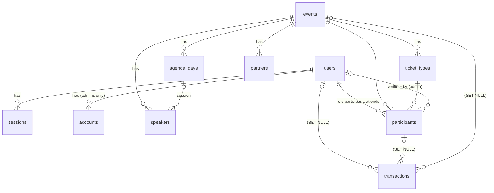

# APCR CMS — Database design

Source: the "APCR CMS Admin Panel (Module 4.14)" design canvas — Login, Dashboard, Participants (list + detail),
Transactions (list + detail), Events (list, form, detail, delete), Email templates.

Stack: Bun · Nuxt 4 · PostgreSQL · Drizzle ORM (`drizzle-orm/bun-sql` + `drizzle-kit`) · Better Auth · Zod · Nuxt UI.

### Runtime: Bun

- Package manager and runtime: `bun install`, `bun --bun nuxt dev`, built with the Nitro `bun` preset (`bun .output/server/index.mjs`).
- Database driver: Bun's built-in Postgres client (`Bun.SQL`) through `drizzle-orm/bun-sql` — no `pg`/`postgres` package.
- Migrations run through `migrate()` from `drizzle-orm/bun-sql/migrator` (`bun run db:migrate`); `drizzle-kit` is only used for `generate` and `studio`.
- `jsonb` columns use our own helper (`server/db/columns.ts`): Drizzle's built-in `jsonb()` together with Bun.SQL stores values as JSON strings.
- Better Auth uses the Drizzle adapter (`provider: "pg"`) on the same database instance.

---

## 1. Principles

| Decision | Choice | Why |
|---|---|---|
| Primary keys | `uuid` (v7, generated in the app) | Time-ordered, so B-tree indexes stay compact; safe to expose in URLs. Better Auth uses the same generator. |
| Human-facing codes | Separate unique columns: `REG-APCR-26-01248`, `INV-APCR-26-01248`, `APCR26-ID-0712` | The design shows these codes in tables, emails and search. |
| Money | `bigint` whole rupiah, `currency` defaults to `IDR` | Every price in the design is whole rupiah; no floats. |
| Time | `timestamptz`; event days as `date`; `events.timezone` defaults to `Asia/Jakarta` | The design shows WIB; participants come from across ASEAN. |
| Statuses | `pgEnum` + display labels in `shared/utils/labels.ts` | The enum is the contract; labels can change without a migration. |
| Transaction details | One `transactions` table; invoice lines, payment details and status history in `jsonb` | Decision: every transaction in one table. Filtered/sorted/summed values stay plain columns. |
| Emails | **Static** — templates in code (`server/services/mail/templates.ts`), not in the database | Decision: static emails. The "Email templates" page is a read-only preview. |
| Deletes | Hard delete, **except** transactions | "Transaction history is kept for financial reporting" → FK `SET NULL` + snapshot columns. |
| Validation | Zod schemas in `shared/schemas/`, shared by server routes and Nuxt UI forms; `jsonb` shapes also have Zod schemas and `$type<>()` | One source of truth. |

---

## 2. Relationships



Total: **4 auth tables + 7 domain tables** (`events`, `agenda_days`, `speakers`, `partners`, `ticket_types`, `participants`, `transactions`).

Admins and participants both live in `users`, told apart by `role`. `participants` only stores a user's
**attendance** of one event (ticket type, verification status, payment status, e-ticket).

---

## 3. Tables

### 3.1 Auth (Better Auth)

`users`, `sessions`, `accounts`, `verifications` — Better Auth tables with plural names (Drizzle adapter `usePlural: true`).
The **admin** plugin adds `role`, `banned`, `ban_reason`, `ban_expires` to `users` and `impersonated_by` to `sessions`.

#### `users` — admins **and** participants

| Column | Type | Notes |
|---|---|---|
| id | uuid | |
| name | varchar | full name |
| email | citext **unique** | one person = one user across events |
| email_verified | boolean | Better Auth |
| image | text null | Better Auth |
| role | varchar | `admin` · `participant` (admin plugin; `defaultRole: "participant"`, `adminRoles: ["admin"]`) |
| banned / ban_reason / ban_expires | | admin plugin |
| phone | varchar null | E.164 — extra field (`user.additionalFields`) |
| organization | varchar null | |
| job_title | varchar null | |
| country | char(2) null | ISO-3166 |
| city | varchar null | |
| tshirt_size | `tshirt_size` null | XS…XXXL |
| meal_preference | varchar null | |
| referral_source | varchar null | |
| created_at / updated_at | timestamptz | |

Profile fields are registered as `additionalFields` with `input: false`, so only the server (registration form / CMS) can set them.

#### Auth rules

- **Admins** sign in with email + password (screen 01) → they have an `accounts` row (provider `credential`). Created by the seed or another admin. Public sign-up is **disabled** (`disableSignUp`).
- **Participants** are created **automatically** when they submit an event registration form (see §6). They have no password or `accounts` row, so they cannot sign in.
- Every CMS route (`/api/admin/**`, admin pages) requires a session **and** `role = 'admin'`.
- If participants ever need to sign in (check status, download e-ticket), add the magic link / email OTP plugin — the tables stay the same.

### 3.2 `events`

| Column | Type | Notes |
|---|---|---|
| id | uuid PK | |
| code | varchar(8) unique | `APCR`, `PRE`, `ATR` — prefix of REG/INV/ticket numbers |
| slug | varchar unique | public page `/events/<slug>` |
| name | varchar(200) | "APCR 2026" |
| tagline | varchar(255) null | |
| description | text | |
| start_date / end_date | date | check `end_date >= start_date` |
| registration_deadline | timestamptz | closes at 23:59 WIB on the chosen day |
| venue_name | varchar | |
| venue_address | text null | |
| city | varchar | |
| capacity | integer | |
| banner_key | text null | object key in Cloudflare R2 |
| status | `event_status` | `draft` · `published` · `archived` |
| registration_open | boolean default true | "Open registration" switch |
| timezone | varchar default `Asia/Jakarta` | |
| registration_seq / invoice_seq | integer default 0 | number counters, incremented with `UPDATE … RETURNING` inside the DB transaction |
| created_by | uuid → users (SET NULL) | |
| created_at / updated_at / published_at | timestamptz | |

### 3.3 `agenda_days`
`id`, `event_id` → events **CASCADE**, `sort_order` int, `label` ("SUMATRA"), `date` date, `theme` varchar, `body` text.
Unique `(event_id, sort_order)`.

### 3.4 `speakers`
`id`, `event_id` → events **CASCADE**, `agenda_day_id` → agenda_days **SET NULL** (the "Session" column), `name`, `title` ("Position & institution"), `category` `speaker_category` (`government` · `business` · `academia` · `communication`), `photo_key` (R2), `status` `publish_status` (`draft` · `published`), `sort_order`, timestamps.

### 3.5 `partners`
`id`, `event_id` → events **CASCADE**, `name`, `logo_key` (R2), `category` `partner_category`
(`academic_home` · `government_regional` · `strategic` · `business_industry` · `knowledge_research` · `technology` · `media`), `sort_order`, timestamps.

### 3.6 `ticket_types`

| Column | Type | Notes |
|---|---|---|
| id, event_id → events CASCADE | | |
| code | varchar(6) | `ID`, `INT`, `CORP` → e-ticket code `APCR26-ID-0712` |
| name | varchar | "Indonesia Delegate" |
| price | bigint | rupiah |
| pax_per_ticket | smallint default 1 | Corporate = 5 ("Rp 15,000,000 / 5 people") |
| quota | integer | |
| ticket_seq | integer default 0 | e-ticket counter |
| is_on_sale | boolean | "On sale" switch |
| sort_order, timestamps | | |

Unique `(event_id, code)`. "Sold" = participants with `payment_status = paid` (computed, not stored).

### 3.7 `participants` — one row = one user attending one event

Personal details live in `users`; this table only holds attendance. Someone attending 3 events = 1 user + 3
`participants` rows; the "Participant detail" page = one user with all their rows ("Registered events").

| Column | Type | Notes |
|---|---|---|
| id | uuid | |
| reg_no | varchar unique | `REG-APCR-26-01248` |
| user_id | → users **CASCADE** | deleting a participant (user) deletes all their registrations and e-tickets |
| event_id | → events **CASCADE** | |
| ticket_type_id | → ticket_types **RESTRICT** | a ticket type in use cannot be deleted |
| extra | jsonb default `{}` | answers to extra, event-specific form fields |
| status | `registration_status` | `pending_verification` · `verified` · `rejected` · `cancelled` |
| payment_status | `payment_status` | `none` · `pending` · `paid` · `expired` · `refunded` — copied from the latest transaction |
| rejection_reason | text null | used in the "rejected" email |
| verified_at / verified_by → users (SET NULL) | | the admin who verified |
| rejected_at / cancelled_at | timestamptz null | |
| ticket_code | varchar unique null | `APCR26-ID-0712`, set once paid |
| ticket_issued_at / checked_in_at | timestamptz null | |
| created_at / updated_at | | "Registered" |

- Partial unique index `(event_id, user_id) WHERE status NOT IN ('rejected','cancelled')` → one active registration per user per event, while re-registering after a rejection is allowed.
- The "Not invoiced yet" / "Not invoiced" labels = `payment_status = none`, told apart by `status`.
- `payment_status` is stored so the participant table can filter and sort by payment status without a join; it is updated in the same DB transaction that changes the transaction.

### 3.8 `transactions` — every transaction, details in `jsonb`

Plain columns only for what is searched, filtered, sorted or summed. Everything else is `jsonb`.

| Column | Type | Notes |
|---|---|---|
| id | uuid | |
| invoice_no | varchar unique | `INV-APCR-26-01248`, also DOKU's `invoice_number` |
| user_id | → users **SET NULL** | deleting a participant keeps the transaction |
| participant_id | → participants **SET NULL** | the invoiced registration |
| event_id | → events **SET NULL** | |
| participant_name / participant_email | varchar | snapshot for search and lists after the user is deleted |
| event_name / ticket_type_name | varchar | snapshot for the "Event" and "Ticket type" columns |
| status | `transaction_status` | `pending` · `paid` · `expired` · `refunded` |
| method | `payment_method` null | `virtual_account` · `qris` · `credit_card` · `bank_transfer` · `e_wallet` |
| total | bigint | "Amount", summed for revenue |
| currency | char(3) default `IDR` | |
| expires_at / paid_at | timestamptz null | expiry job and 24-hour reminder |
| items | jsonb | invoice lines |
| payment | jsonb | DOKU payment details |
| history | jsonb (array) | the "Status history" card |
| created_at / updated_at | timestamptz | "Invoice created", "Date" column |

JSON shapes (`shared/schemas/transaction.ts`, typed with `.$type<>()`):

```ts
// items
{
  lines: { description: string; note?: string; qty: number; unitPrice: number; subtotal: number }[]
  subtotal: number
  discount: number
  // e.g. "VA service fee", unitPrice 4440, subtotal 0, note "Covered by the organizers"
}

// payment
{
  channel?: string          // "BCA", "BNI", "Mandiri" — from the DOKU notification
  vaNumber?: string
  dokuRequestId?: string    // Request-Id used to create the checkout
  dokuPaymentUrl?: string   // DOKU Checkout URL sent to the participant
  dokuTokenId?: string
  dokuReference?: string
  refundAmount?: number
  refundedAt?: string
  adminNote?: string
  reminderSentAt?: string
  raw?: unknown             // latest DOKU notification payload, for auditing
}

// history (chronological, append-only)
{
  type: 'created' | 'invoice_sent' | 'paid' | 'ticket_sent' | 'expired' | 'refunded' | 'note'
  at: string                // ISO
  description?: string      // "VA BCA", "APCR26-ID-0712"
  actor?: { id: string; name: string } | null   // null = system
}[]
```

Trade-off: values inside `items`/`payment`/`history` cannot be filtered efficiently; if that is ever needed (e.g. filter by bank), move the field to a plain column.

### 3.9 Emails (no table)

Static templates in code (`server/services/mail/templates.ts`):
`registration-received`, `registration-verified`, `registration-rejected`, `payment-reminder`, `payment-success`,
`invoice-expired`, `refund-processed`, `event-reminder-h3`, `event-thank-you`.

- Content comes from the 9 templates in the design; values are filled from participant/transaction/event data.
- The CMS "Email templates" page renders the same templates as a read-only preview.
- Sending is recorded in the transaction `history` (`invoice_sent`, `ticket_sent`). There is no separate email log; opens are not tracked.

---

## 4. Indexes

| Table | Index | For |
|---|---|---|
| participants | `(event_id, status)`, `(event_id, payment_status)`, `(created_at desc)`, `(user_id)` | participant table filters and sorting, dashboard, participant detail |
| users | `(role)`; GIN `pg_trgm` on `name`, `email::text`, `organization` | "Search name, email or organization" |
| transactions | `(status, created_at desc)`, `(event_id)`, `(user_id)`, `(participant_id)`, `(expires_at) WHERE status='pending'` | transaction list, participant history, expiry and reminder jobs |
| transactions | GIN `pg_trgm` on `invoice_no`, `participant_name` | "Search transaction ID or participant" |

Extensions: `citext`, `pg_trgm`.

## 5. Dashboard (no extra tables)
Every number is an aggregate query per event: total registrations, pending verification, paid, total revenue (`sum(total) where status='paid'`), registrations over 14 days (`(created_at at time zone tz)::date`), quota per ticket type, payment status breakdown. If this gets slow → materialized view.

## 6. Status flow (enforced in `server/services/`)

Public registration (one DB transaction):

1. Validate the input with Zod.
2. Look up `users` by email.
   - Not found → create a user with `role = 'participant'`, no password, with the profile fields.
   - Found with `role = 'participant'` → fill only the profile fields that are still empty (the form is unauthenticated, so nobody can overwrite someone's profile just by knowing their email).
   - Found with `role = 'admin'` → use that user; the profile and role are not touched.
3. Reject if the user already has an active registration for this event (also enforced by the partial unique index).
4. Check the event is `published` + `registration_open` + before `registration_deadline`, and the ticket type is `is_on_sale` with quota left (the ticket type row is locked `FOR UPDATE`).
5. Insert the `participants` row with `reg_no` from `events.registration_seq`.

```
Public form ──► user (created/filled) + participant(pending_verification, payment none)
                                                                  + email registration-received
Admin verifies ──► verified + transaction(pending, expires in 48 hours,
                   history: created, invoice_sent) + DOKU Checkout link
                                                                  + email registration-verified
Admin rejects ──► rejected (+ rejection_reason)                    + email registration-rejected
Every 15 min, 24 h before deadline ──►                             email payment-reminder
DOKU notification SUCCESS ──► transaction paid (history: paid, ticket_sent),
                              participant.payment_status paid, ticket_code set
                                                                  + email payment-success (QR)
Every 5 min, past deadline ──► transaction expired, payment_status expired
                                                                  + email invoice-expired
Admin refunds ──► transaction refunded, participant cancelled      + email refund-processed
Daily 08:00 WIB ──► 3 days before start: event-reminder-h3; 1 day after end: event-thank-you
```

## 7. Integrations

### 7.1 DOKU Checkout (payments)

Docs: https://docs.doku.com/accept-payments/integration-tools/doku-checkout

- When an admin verifies a registration, the server calls `POST {DOKU_BASE_URL}/checkout/v1/payment` with
  `order.invoice_number = transactions.invoice_no`, `order.amount = total`, `order.line_items`, `order.callback_url`
  (`/payment/finish`), `payment.payment_due_date` (minutes left until `expires_at`), `customer`, and
  `additional_info.override_notification_url` (`/api/payments/doku/notify`).
- The returned `response.payment.url` is stored in `payment.dokuPaymentUrl` and sent in the "Verified + invoice" email.
- The participant picks a method on the DOKU page (VA, QRIS, credit card, e-wallet…); the method and bank come from the notification → `method` + `payment.channel`.
- Notification endpoint `POST /api/payments/doku/notify`:
  1. Verify the `Signature` header (HMAC-SHA256 with the DOKU secret key, Request-Target = the notification path) — reject on mismatch.
  2. Find the transaction by `order.invoice_number`, check the amount equals `total`.
  3. Idempotent: if already `paid`, answer 200 without changes.
  4. In one DB transaction: `paid`, `paid_at`, `participants.payment_status`, `ticket_code`, append `history`; then send the e-ticket email.
- Credentials via env: `DOKU_CLIENT_ID`, `DOKU_SECRET_KEY`, `DOKU_BASE_URL` (sandbox `https://api-sandbox.doku.com` / production `https://api.doku.com`). The notification URL path must also be set in the DOKU Back Office (the override only changes the domain).
- Refunds: the CMS marks the transaction `refunded` and records the amount. Returning the money through DOKU depends on the payment method; for VA/bank transfer the organizers return it manually.

### 7.2 Cloudflare R2 (uploads)

- Event banners, speaker photos and partner logos live in an R2 bucket. The database only stores the **object key** (`events/<uuid>.jpg`); the public URL is `R2_PUBLIC_URL` + key, so changing domains needs no data migration.
- Access through Bun's built-in S3 client (`Bun.S3Client`, R2 endpoint) — no AWS SDK.
- Upload: the browser asks `POST /api/admin/uploads` for a presigned PUT URL (admins only; type and size validated with Zod: JPG/PNG/WebP, ≤ 5 MB), then uploads straight to R2.
- Deleting an event/speaker/partner or replacing an image deletes the old object after the DB transaction succeeds.
- Env: `R2_ACCOUNT_ID`, `R2_ACCESS_KEY_ID`, `R2_SECRET_ACCESS_KEY`, `R2_BUCKET`, `R2_PUBLIC_URL`.

### 7.3 Public pages

- `/` — published events.
- `/events/[slug]` — details, agenda, published speakers, partners by category, ticket types on sale.
- `/events/[slug]/register` — registration form (flow in §6). Participant types = the event's ticket types.
- `/payment/finish` — where DOKU Checkout sends the payer back.
- Participants do not sign in; status updates arrive by email.

## 8. Decisions

| # | Question | Decision |
|---|---|---|
| 1 | Roles | Only `admin` and `participant` |
| 2 | Public form and event page | In scope for this app |
| 3 | Payment gateway | DOKU Checkout |
| 4 | File storage | Cloudflare R2 |
| 5 | Deletes | Permanent (hard delete); transactions are kept |
| – | Emails | Static, in code |
| – | Transactions | One table, details in `jsonb` |
| – | Admins and participants | One `users` table told apart by `role`; registering for an event creates a `participant` user |
| – | Language | All code, comments, docs, UI copy and emails in English |
| – | Design | Core Design System (gold brand `#ECBD56`, slate neutrals, Rethink Sans + JetBrains Mono) mapped onto Nuxt UI in `app/assets/css/main.css` and `app/app.config.ts` |
