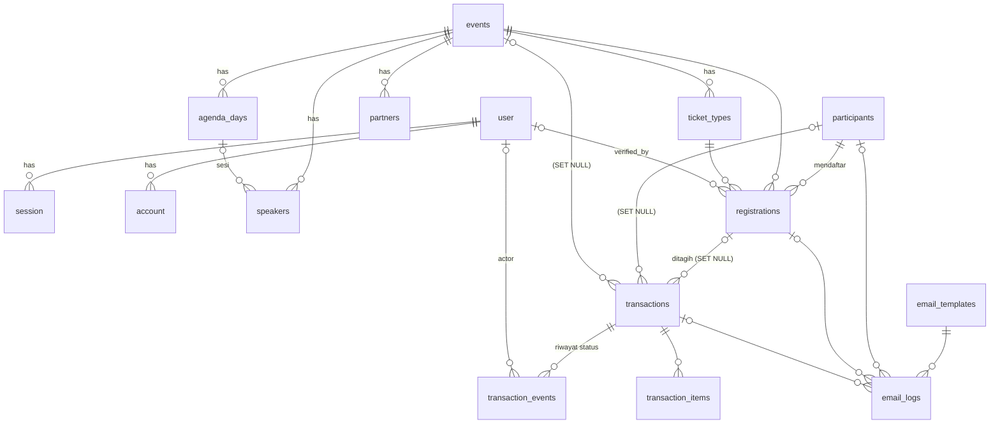

# APCR CMS — Rencana Database

Sumber: desain kanvas "APCR CMS Admin Panel (Modul 4.14)" — Login, Dashboard, Peserta (daftar + detail),
Transaksi (daftar + detail), Event (daftar, form, detail, hapus), Template email.

Stack: Bun · Nuxt 4 · PostgreSQL · Drizzle ORM (`drizzle-orm/bun-sql` + `drizzle-kit`) · Better Auth · Zod · Nuxt UI.

### Runtime: Bun

- Package manager & runtime: `bun install`, `bun --bun nuxt dev`, build dengan Nitro preset `bun` (`bun .output/server/index.mjs`).
- Driver DB: client Postgres bawaan Bun (`Bun.SQL`) lewat `drizzle-orm/bun-sql` — tanpa paket `pg`/`postgres`.
- Migrasi & seed: `bunx drizzle-kit generate` / `bunx drizzle-kit migrate`, `bun run server/db/seed.ts`.
- Better Auth memakai adapter Drizzle (`provider: "pg"`) di atas instance db yang sama.
- Catatan: `drizzle-kit` menjalankan migrasi dengan driver Node miliknya sendiri; kalau `bun-sql` belum didukung di sana, migrasi dijalankan lewat `migrate()` dari `drizzle-orm/bun-sql/migrator` di script Bun.

---

## 1. Prinsip

| Keputusan | Pilihan | Alasan |
|---|---|---|
| Primary key | `uuid` (v7, digenerate di app) | Urut waktu → index B-tree tetap rapi; aman diekspos di URL. Better Auth diset `generateId: "uuid"` supaya seragam. |
| Kode yang dilihat manusia | Kolom terpisah, unik: `PST-000712`, `REG-APCR-26-01248`, `INV-APCR-26-01248`, `APCR26-ID-0712` | Desain menampilkan kode ini di tabel, email, dan pencarian. |
| Uang | `bigint` rupiah utuh (tanpa desimal), `currency` default `IDR` | Semua harga di desain bulat rupiah; hindari float. |
| Waktu | `timestamptz`; tanggal acara `date`; `events.timezone` default `Asia/Jakarta` | Desain menampilkan "WIB"; peserta lintas ASEAN. |
| Status | `pgEnum` + label Bahasa Indonesia di UI (map di `shared/`) | Enum DB = kontrak; label bisa berubah tanpa migrasi. |
| Hapus | Hard delete sesuai desain, **kecuali** transaksi | Desain: "Riwayat transaksi tetap tersimpan untuk laporan keuangan" → FK `SET NULL` + kolom snapshot. |
| Validasi | Zod schema dari `drizzle-zod` (`createInsertSchema`) lalu di-extend | Satu sumber kebenaran untuk server route & form Nuxt UI. |

---

## 2. Diagram relasi



---

## 3. Tabel

### 3.1 Auth (Better Auth, dibuat via `npx @better-auth/cli generate`)

`user`, `session`, `account`, `verification` — standar Better Auth.
Plugin **admin** menambah di `user`: `role`, `banned`, `ban_reason`, `ban_expires`; di `session`: `impersonated_by`.

- Login hanya email + password (layar 01). Registrasi publik **dimatikan** (`disableSignUp`); akun admin dibuat lewat seed / admin lain.
- Role awal: `admin`. (Lihat pertanyaan terbuka #1.)
- Peserta **bukan** user Better Auth — mereka mendaftar lewat form publik tanpa login.

### 3.2 `events`

| Kolom | Tipe | Catatan |
|---|---|---|
| id | uuid PK | |
| code | varchar(8) unik | `APCR`, `PRE`, `ATR` — prefix nomor REG/INV/tiket |
| slug | varchar unik | untuk "Lihat di website" |
| name | varchar(200) | "APCR 2026" |
| tagline | varchar(255) null | opsional |
| description | text | |
| start_date / end_date | date | check `end_date >= start_date` |
| registration_deadline | timestamptz | "25 November 2026, 23.59 WIB" |
| venue_name | varchar | "Santika Premiere Dyandra" |
| venue_address | text null | |
| city | varchar | "Medan" |
| capacity | integer | 1.450 |
| banner_url | text null | file upload 1920×1080 ≤ 5 MB |
| status | `event_status` | `draft` · `published` · `archived` |
| registration_open | boolean default true | toggle "Buka pendaftaran" |
| timezone | varchar default `Asia/Jakarta` | |
| registration_seq / invoice_seq | integer default 0 | counter nomor; di-increment `UPDATE … RETURNING` dalam transaksi |
| created_by | uuid → user (SET NULL) | |
| created_at / updated_at / published_at | timestamptz | |

### 3.3 `agenda_days`
`id`, `event_id` → events **CASCADE**, `sort_order` int, `label` ("SUMATRA"), `date` date, `theme` varchar, `body` text.
Unik `(event_id, sort_order)`.

### 3.4 `speakers`
`id`, `event_id` → events **CASCADE**, `agenda_day_id` → agenda_days **SET NULL** (kolom "Sesi"), `name`, `title` ("Jabatan & institusi"), `category` `speaker_category` (`government` · `business` · `academia` · `communication`), `photo_url`, `status` `publish_status` (`draft` · `published`), `sort_order`, timestamps.

### 3.5 `partners`
`id`, `event_id` → events **CASCADE**, `name`, `logo_url`, `category` `partner_category`
(`academic_home` · `government_regional` · `strategic` · `business_industry` · `knowledge_research` · `technology` · `media`), `sort_order`, timestamps.

### 3.6 `ticket_types`

| Kolom | Tipe | Catatan |
|---|---|---|
| id, event_id → events CASCADE | | |
| code | varchar(6) | `ID`, `INT`, `CORP` → kode e-tiket `APCR26-ID-0712` |
| name | varchar | "Indonesia Delegate" |
| price | bigint | rupiah |
| pax_per_ticket | smallint default 1 | Corporate = 5 ("Rp 15.000.000 / 5 orang") |
| quota | integer | |
| ticket_seq | integer default 0 | counter kode e-tiket |
| is_on_sale | boolean | toggle "Dijual" |
| sort_order, timestamps | | |

Unik `(event_id, code)`. "Terjual" = jumlah registrasi `payment_status = paid` (dihitung, tidak disimpan).

### 3.7 `participants`

| Kolom | Tipe | Catatan |
|---|---|---|
| id | uuid | |
| code | varchar unik | `PST-000712` (dari sequence PG `participant_code_seq`) |
| full_name | varchar | |
| email | citext unik | 1 orang = 1 profil, bisa ikut banyak event |
| phone | varchar | E.164 |
| organization | varchar | "Instansi" |
| job_title | varchar | |
| country | char(2) | ISO-3166 |
| city | varchar | |
| tshirt_size | `tshirt_size` null | XS…XXXL |
| meal_preference | varchar null | "Halal" |
| referral_source | varchar null | "Sumber info" |
| extra | jsonb default `{}` | field form tambahan per event tanpa migrasi |
| created_at / updated_at | | |

### 3.8 `registrations` (pendaftaran per event)

| Kolom | Tipe | Catatan |
|---|---|---|
| id | uuid | |
| reg_no | varchar unik | `REG-APCR-26-01248` |
| participant_id | → participants **CASCADE** | hapus peserta = hapus pendaftaran & e-tiket |
| event_id | → events **CASCADE** | |
| ticket_type_id | → ticket_types **RESTRICT** | tiket yang sudah dipakai tidak bisa dihapus |
| status | `registration_status` | `pending_verification` · `verified` · `rejected` · `cancelled` |
| payment_status | `payment_status` | `none` · `pending` · `paid` · `expired` · `refunded` — **denormalisasi** dari transaksi terakhir |
| rejection_reason | text null | dipakai di email "ditolak" |
| verified_at / verified_by → user | | |
| rejected_at / cancelled_at | timestamptz null | |
| ticket_code | varchar unik null | `APCR26-ID-0712`, diisi saat lunas |
| ticket_issued_at / checked_in_at | timestamptz null | |
| created_at / updated_at | | "Tanggal daftar" |

- Partial unique index: `(participant_id, event_id) WHERE status NOT IN ('rejected','cancelled')` → bisa "daftar ulang" setelah ditolak.
- Label UI "Belum ditagih" / "Tidak ditagih" = `payment_status = none` dibedakan oleh `status`.
- Kenapa `payment_status` disimpan: tabel peserta di-filter & di-sort per status bayar untuk ribuan baris; diperbarui di service yang sama yang mengubah transaksi (satu DB transaction).

### 3.9 `transactions` (invoice)

| Kolom | Tipe | Catatan |
|---|---|---|
| id | uuid | |
| invoice_no | varchar unik | `INV-APCR-26-01248` |
| registration_id | → registrations **SET NULL** | |
| participant_id | → participants **SET NULL** | |
| event_id | → events **SET NULL** | |
| participant_name / participant_email / event_name / ticket_type_name | snapshot | tetap terbaca setelah data asal dihapus |
| status | `transaction_status` | `pending` · `paid` · `expired` · `refunded` |
| method | `payment_method` null | `virtual_account` · `qris` · `credit_card` · `bank_transfer` |
| channel | varchar null | `BCA`, `BNI`, `Mandiri` |
| va_number | varchar null | |
| gateway / gateway_ref | varchar null | `pg_7f3c91e2a04b` |
| subtotal / discount / total | bigint | |
| refund_amount | bigint null | |
| admin_note | text null | |
| issued_at / expires_at / paid_at / refunded_at | timestamptz | batas bayar 48 jam |
| created_at / updated_at | | |

### 3.10 `transaction_items`
`id`, `transaction_id` → **CASCADE**, `description` ("Tiket Indonesia Delegate"), `note` ("Ditanggung panitia"), `qty`, `unit_price`, `subtotal` (bigint; boleh 0 meski unit_price > 0 — biaya VA ditanggung panitia).

### 3.11 `transaction_events` (kartu "Riwayat status")
`id`, `transaction_id` → **CASCADE**, `type` `transaction_event_type` (`created` · `invoice_sent` · `paid` · `ticket_sent` · `expired` · `refunded` · `note`), `description`, `actor_id` → user **SET NULL** (null = sistem), `metadata` jsonb, `created_at`.

### 3.12 `email_templates`
`id`, `key` `email_template_key` unik (`registration_received` · `registration_verified` · `registration_rejected` · `payment_reminder` · `payment_success` · `invoice_expired` · `refund_processed` · `event_reminder_h3` · `event_thank_you`), `group` (`registration` · `payment` · `event`), `name`, `trigger_description`, `subject`, `preheader`, `heading`, `body` (markdown + placeholder `{{participant.name}}`, `{{invoice.total}}`, …), `cta_label`, `note`, `include_qr` bool, `is_active` bool, `updated_by`, timestamps.

Isi awal 9 template dari desain lewat seed.

### 3.13 `email_logs`
`id`, `template_key`, `participant_id`/`registration_id`/`transaction_id` (semua **SET NULL**), `to_email`, `subject`, `status` `email_status` (`queued` · `sent` · `delivered` · `opened` · `bounced` · `failed`), `provider_message_id`, `error`, `sent_at`, `opened_at`, `created_at`.
Dipakai untuk "Email tagihan terkirim · dibuka 15.32" dan riwayat email di detail peserta.

---

## 4. Index

| Tabel | Index | Untuk |
|---|---|---|
| registrations | `(event_id, status)`, `(event_id, payment_status)`, `(created_at desc)`, `(participant_id)` | filter & sort tabel peserta, dashboard |
| transactions | `(status, created_at desc)`, `(event_id)`, `(registration_id)`, `(expires_at) WHERE status='pending'` | daftar transaksi, job kedaluwarsa & pengingat 24 jam |
| participants | GIN `pg_trgm` pada `full_name`, `email`, `organization` | "Cari nama, email, atau instansi" |
| transactions | GIN `pg_trgm` pada `invoice_no`, `participant_name` | "Cari ID transaksi atau nama peserta" |
| email_logs | `(participant_id, created_at desc)`, `(transaction_id)` | |

Extension: `citext`, `pg_trgm`.

## 5. Dashboard (tanpa tabel tambahan)
Semua angka dihitung dengan query agregat per event: total pendaftar, menunggu verifikasi, lunas, total pendapatan (`sum(total) where status='paid'`), pendaftaran 14 hari (`date_trunc('day', created_at at time zone tz)`), kuota per tipe tiket, sebaran status bayar. Kalau nanti lambat → materialized view.

## 6. Alur status (aturan yang dijaga di service layer)

```
Form publik ──► registration(pending_verification, payment none)  + email registration_received
Admin verifikasi ──► verified + transaction(pending, expires +48 jam) + email registration_verified
Admin tolak ──► rejected (+ rejection_reason)                        + email registration_rejected
Cron −24 jam ──►                                                    email payment_reminder
Webhook gateway paid ──► transaction paid, registration.payment_status paid,
                         ticket_code diisi                            + email payment_success (QR)
Cron lewat batas ──► transaction expired, payment_status expired     + email invoice_expired
Admin refund ──► transaction refunded, registration cancelled        + email refund_processed
```
Setiap perubahan transaksi menulis `transaction_events`.

## 7. Struktur file Drizzle

```
server/db/
  schema/
    auth.ts          # hasil better-auth CLI
    enums.ts
    events.ts        # events, agenda_days, speakers, partners, ticket_types
    participants.ts  # participants, registrations
    transactions.ts  # transactions, transaction_items, transaction_events
    emails.ts        # email_templates, email_logs
    relations.ts
    index.ts
  migrations/        # drizzle-kit generate
  seed.ts            # admin awal, 9 template email, data contoh dari desain (bun run)
  migrate.ts         # migrate() via drizzle-orm/bun-sql/migrator
  index.ts           # drizzle({ client: new SQL(DATABASE_URL), schema })
shared/schemas/      # Zod (drizzle-zod + extend) dipakai server & client
drizzle.config.ts
```

## 8. Pertanyaan terbuka

1. **Role admin** — cukup satu role `admin`, atau perlu dipisah (mis. `superadmin`, `finance` untuk refund, `staff` hanya verifikasi)?
2. **Form Registration publik & halaman event publik** — masuk scope app Nuxt ini, atau hanya CMS (modul 4.14)?
3. **Payment gateway** — Midtrans / Xendit / lainnya? Menentukan kolom `gateway_*` dan format webhook.
4. **Upload file** (banner, foto speaker, logo partner) — disimpan di S3/R2 atau disk lokal?
5. **Template email** — global untuk semua event (rencana di atas), atau bisa di-override per event?
6. **Hapus event/peserta** — tetap hard delete seperti desain, atau soft delete (`deleted_at`) supaya bisa dipulihkan?
